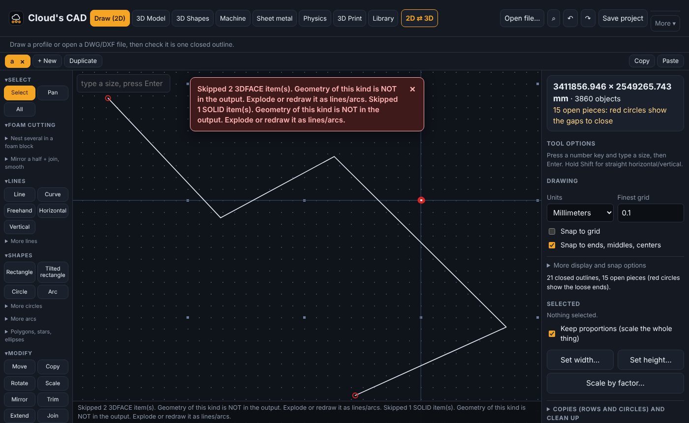
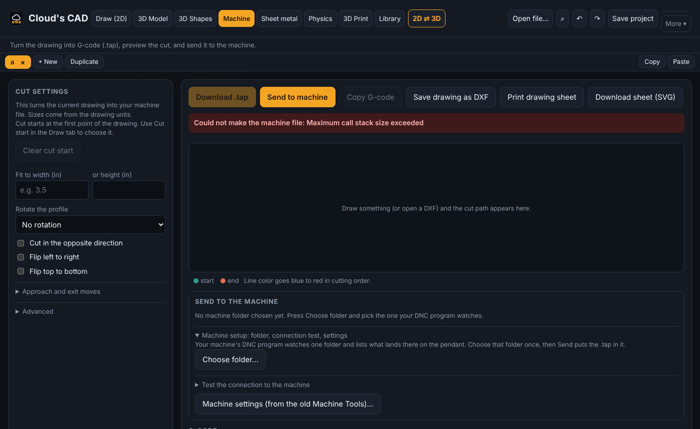
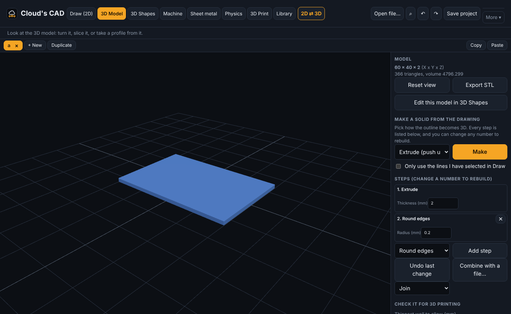
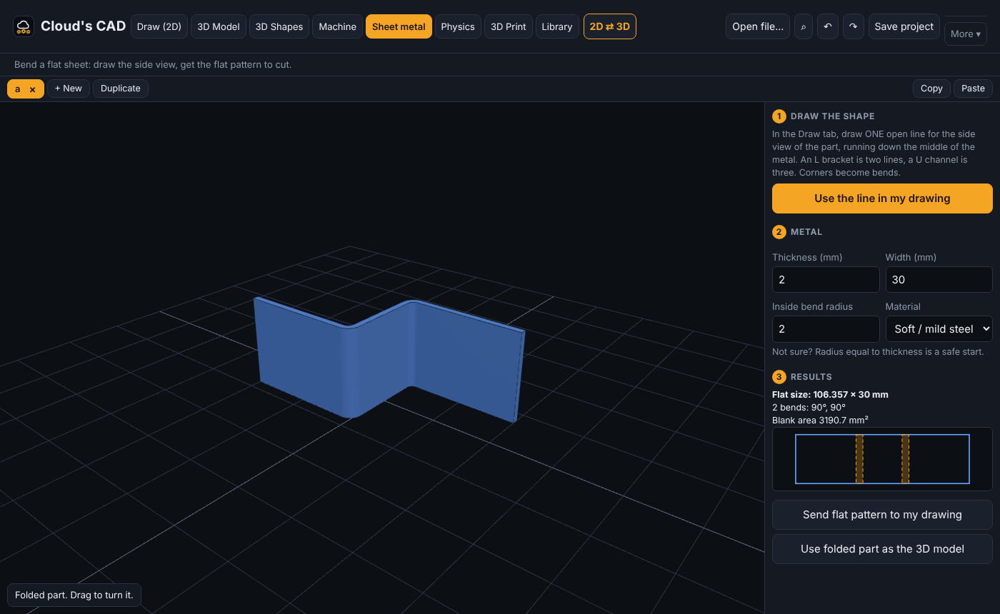
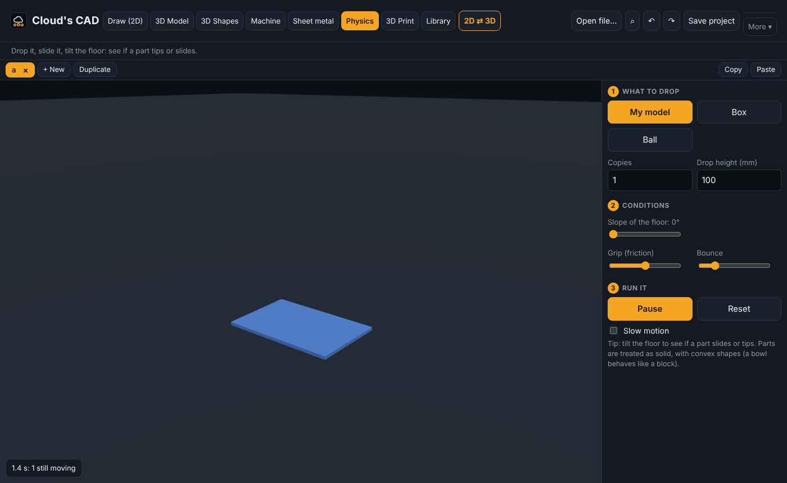

# Cloud's CAD

**A free, offline, open-source CAD/CAM program that does what FreeCAD + LibreCAD + a paid CAM package do, in one simple window.** Draw (or open a DWG/DXF), and get G-code for a hotwire foam cutter, a 3D print, a flat sheet-metal pattern, or a quick physics test. One HTML file or a portable Windows app. No account, no cloud, no subscription.

Born in a foam crown molding shop, where the only affordable CAD/CAM options were either hard to learn or locked behind a paywall.



**Status:** v0.2 beta. Used on a real ExtraTech hotwire machine (via its DNC folder). 3D-printer links are only tested against a simulator. Please report bugs.
**License:** GPL v3 (free to use, modify, and share; derivatives stay open)

## What it does
| Tab | What you can do |
|---|---|
| **Draw (2D)** | Lines, arcs, circles, fillets, trim, mirror, dimensions. Opens **DWG, DXF**, SVG, pictures (trace). Nest profiles in a foam block. |
| **Machine** | Turns the drawing into hotwire `.tap` G-code, shows it, and **plays the cut** as an animation before you waste foam. Sends it to your machine's folder. |
| **3D** | Extrude, **spin (revolve), sweep, loft**; round/chamfer edges, hollow out, grow/shrink for clearance, screw holes. Every step is a list with editable numbers, so change one and the model rebuilds. **Print check** (sealed? thin walls? overhangs? best way to lay it down) and **fill the print bed**. |
| **3D Build** | Blender-style modelling: cubes, spheres, join/cut/overlap, extrude faces. |
| **Sheet metal** | Draw the side view as one line, set thickness and bend radius, get the folded part and a **flat pattern** with bend lines. |
| **Physics** | Drop your part, tilt the floor, see if it tips or slides. |
| **3D Print** | Built-in slicer, G-code, USB / Moonraker / OctoPrint control. |
| **Library** | Save and find profiles by customer, picture and notes. |

| Machine tab | 3D tab |
|---|---|
|  |  |
| **Sheet metal** | **Physics** |
|  |  |

Not here (yet): true NURBS surfaces, STEP files, FEA, parametric 2D constraints. See [ROADMAP.md](ROADMAP.md). New here? Read the **[Getting started guide](GUIDE.md)**.

## Machine support
| Machine type | Controller / firmware | Connection | State |
|---|---|---|---|
| Hotwire foam cutters | ExtraTech "uCito" (Hotwire8700) | `.tap` file into the DNC watch folder | works on a real machine |
| 3D printers | Marlin, Klipper, OctoPrint | USB serial, Moonraker, OctoPrint | simulator-tested only |
| CNC routers/mills | GRBL, LinuxCNC | planned | not started |

## Interoperability rules
- Compatibility with other programs (including BobCAD) goes through open/published formats and files you export yourself.
- No decompiling, cracking, or copying proprietary code, assets, or branding.
- Third-party code is used only under compatible licenses, with notices kept intact.

## Credits and licenses
Built on great open-source work, with thanks to the authors:
[three.js](https://threejs.org) (MIT), [Manifold](https://github.com/elalish/manifold) (Apache-2.0, solid modelling), [Rapier](https://rapier.rs) (Apache-2.0, physics), [LibreDWG](https://www.gnu.org/software/libredwg/) via @mlightcad/libredwg-web (GPL-3.0, DWG reading), dxf-parser, Clipper (Boost), three-bvh-csg / three-mesh-bvh (MIT), mdb-reader, CuraEngine WebAssembly (AGPL-3.0, optional 3D print slicing). FreeCAD, LibreCAD and Blender were inspirations; no code was copied from them.

## Related free tools
- [FreeCAD](https://www.freecad.org), [LibreCAD](https://librecad.org): full-featured open CAD (steeper learning curve).
- [Modly](https://github.com/lightningpixel/modly): photo-to-3D-model; save its result as STL/GLB and open it in the 3D tab.
- PrusaSlicer / Cura / Bambu Studio for printing if you prefer them.

## Contributing
Issues and ideas are welcome. Tests: `cd web && npm install && npm test`. Build the single file with `node build.mjs`.

## 3D Build (new): a simple Blender-style modeller
Open the **3D Build** tab. Add a cube, sphere, cylinder, cone, torus, wedge or plane, then move, turn and resize with the gizmo (keys G, R, S) or type exact numbers. **Join**, **Cut** and **Overlap** combine two shapes (click one, Shift+click the other). Mirror, make rows of copies, and Undo/Redo. **Tab** enters edit mode: pick points or faces, press **E** to extrude a face and drag the arrow, or split faces smaller. Send the result to the 3D tab (then 3D Print) or save STL/OBJ. Not a full Blender: no sculpting, bevel, loop cuts, materials or animation yet.

## 3D printing (new)
Open the **3D Print** tab with any 3D model. Built-in slicer (walls, top/bottom skins, infill, skirt/brim, supports, retraction) with a layer preview, G-code export, and direct printer control:
- **USB** (Marlin-style firmware): Connect, preheat, jog, start, pause, cancel, emergency stop.
- **Network** (Klipper/Moonraker or OctoPrint): upload and start. Needs the desktop app (browsers block these calls).
Limits: basic slicer (no bridging, tree supports, gyroid, ironing); not tested on real printers yet, so watch the first layer. Bambu Lab printers are not supported (use Bambu Studio).
- **Cura engine built in (desktop app, default):** CuraEngine compiled to WebAssembly (AGPL-3.0) is bundled, so you get a real slicer with supports, bridging and tuned walls and nothing to install. The browser-only page uses the basic slicer.
- **PrusaSlicer (optional, desktop app):** install [PrusaSlicer](https://www.prusa3d.com/prusaslicer/) (free, AGPL). Cloud's CAD finds it, sends your model and settings to it, and previews and sends the result. Nothing is bundled or downloaded. SuperSlicer should work the same way (untested). OrcaSlicer and Cura use different command lines and are not connected yet.

## Shop tools (new)
- **Library by customer:** save each customer's profiles under their name, filter the library by customer (or see them grouped), and use "Save every separate piece as its own profile" when a customer sends several styles in one file. Export just one customer if you want to send or back up only theirs.
- **Dimensions**: Dimension, Angle and Radius tools leave measurements on the drawing (saved with the project and printed on the drawing sheet; Clear dims removes them). Reverse flips cut direction; Length and area reads out the selection.
- **Opens DWG and DXF**: AutoCAD .dwg files are read offline with LibreDWG (GPL-3.0, WebAssembly); blocks and ellipses are expanded. 3D solids, hatches and text are skipped.
- **Play the cut**: the Machine tab animates the wire along the finished G-code (play, pause, speed, scrub) so mistakes show before foam is cut.
- **Machine connection test** (desktop app): Machine tab → Test the connection checks the controller answers on the network (ping + open ports). Read-only, sends nothing. See MACHINE-NOTES.md.
- **Reference pictures:** attach a photo or screenshot to a profile (Add photo, Ctrl+V paste, drag and drop), or press "Snip from drawing" to save a clean picture of the drawing with its size. Click any card to see the picture large next to the drawing. Pictures travel with Export library.
- **Update a saved profile:** Open it from the Library, make your changes, go back to the Library tab and press "Update ... with the drawing". The name, customer, notes and picture stay. (Edit on a card still changes just the text, and has a box to replace the shape too.)
- **Machine settings:** in the Machine tab, open the controller settings file from the old Machine Tools suite (Hotwire8700.dbi). See every setting in plain words (table size, speeds, the nine cutting-material presets), edit the safe ones (the dangerous ones are locked until you unlock them), compare two files, save a list of changes and print a settings sheet. It can also save your changes as the controller's own text commands (draft). It does not send anything to the controller yet.
- **Send to machine:** in the Machine tab, choose the folder your DNC program watches (for example C:\CODE) once, then press Send to machine and the .tap lands there and shows on the pendant. It asks before replacing a file with the same name. Desktop app: plain folder; Chrome/Edge: asks once and remembers; other browsers just download.
- **Workstations:** open several drawings at once in the tab bar under the header (+ New, Duplicate, double-click to rename). Copy pieces in one and Paste into another (Ctrl+C / Ctrl+V; units convert). All of them are restored when you reopen the app.
- **Add drawing...** puts a second file into the open drawing (converts inches/mm).
- **Clean up the file** removes duplicate, overlapping and tiny loose pieces and closes small gaps. Files whose size looks wrong for their units trigger a question.
- **Mirror + join** turns a half profile into one closed outline. **Smooth** turns jagged traced lines into smooth curves and keeps corners.
- **Nest in a foam block** lines closed profiles up in a row inside a block you size, then joins them with thin in-and-out tether lines so the wire follows one path (top half, then the other half, or one closed loop).
- **Library** tab: save profiles with customer/tags/notes, search, insert/open, find the closest match to the open drawing (any size, turned or flipped), export/import a backup.
- **History** keeps earlier versions of your drawing automatically; Undo goes back 5000 steps and opening a file no longer erases it.


## Download
Get the latest build from the **Releases** page (Windows `.exe`, Linux, and a single-file `clouds-cad.html` that runs in any browser). The Windows build is **unsigned**, so Windows SmartScreen will warn you the first time. Mac and phone builds are not provided.

## Build it yourself
Needs Node.js 20+.
```
cd web
npm install
npm test            # unit + UI tests
node build.mjs      # writes ../clouds-cad.html and ../mobile/
```
Desktop app (Electron):
```
cp clouds-cad.html desktop/app.html
cd desktop
npm install
npx electron .                                  # run it
npx electron-builder --config eb.json --win portable   # Windows exe
```

## Not done yet / honest limits
- No live connection to a machine controller yet. "Send to machine" copies the .tap into the folder your DNC program watches.
- "Save as controller commands" in Machine settings is a draft and has not been checked against a real controller.
- Drawing dimensions are not constraints (they do not drive the shape). Parametric constraints are on the roadmap.
- Bambu Lab printers are not supported.

## Contributing
Issues and pull requests are welcome. Run `npm test` in `web/` before sending a change, and keep the interface simple: few buttons, plain words.
